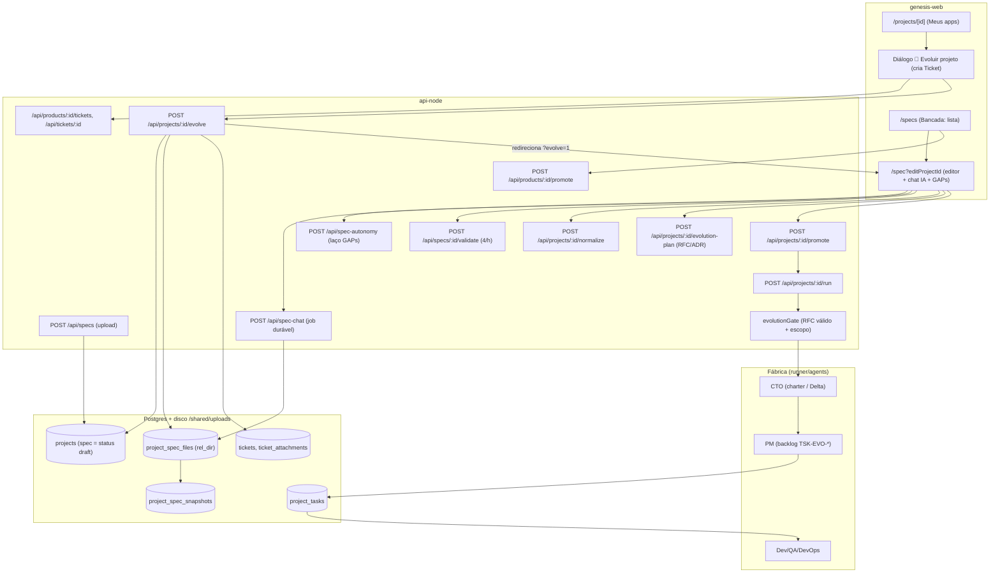

> **Jean Ol'Bar** — AI Engineer · jean@zentriz.com.br

# Evoluir projeto (frente B) — estado atual da Bancada

**Data:** 2026-11-03 · **Escopo:** somente leitura do código (branch `dev`), sem executar nada, sem produção.
**Pergunta:** como a Bancada funciona HOJE, para decidir como o fluxo "🔄 Evoluir projeto" passa a viver nela, com cards de 3 tipos (Evolução, Correção, Recurso novo) que geram especificações ligadas ao card.

**Convenções.** Caminhos são relativos a `applications/` (api = `services/api-node/src/`, web = `apps/genesis-web/`, runner = `orchestrator/runner.py`). `[não verificado]` marca o que foi inferido do código e não confirmado em execução, banco ou produção. Nenhum teste foi rodado; a lista de testes é de existência.

---

## 1. Resumo

1. **O "card" já existe, com outro nome: Ticket (RFC-0009, migração 128).** Tabela `tickets` com `change_kind` ∈ `evolution | fix | feature`, número por produto (`TK-0012`), anexos, status do pedido (`open/promoted/delivered/rejected`) e estado de execução derivado do projeto filho (`api/db/migrations/128_tickets.sql:15-48`, `api/services/tickets.ts:20-37`, `api/routes/tickets.ts:87-302`). Os três tipos que o Jean pediu são exatamente os `TICKET_CHANGE_KINDS` ("evolução", "correção", "recurso novo", `services/tickets.ts:22,28-32`). O estudo de 2026-09-11 dizia "zero ocorrências de ticket"; está **desatualizado** (commit `cc7bb97`, "feat(tickets): RFC-0009").
2. **Mas o Ticket NÃO vive na Bancada.** Toda a UI de ticket está em `app/(dashboard)/projects/[id]/page.tsx` (diálogo "🔄 Evoluir projeto", `:1679`; estado `:175-178,415-427`; fila `:980-1060`). A Bancada (`/spec`, `/specs`) não tem uma linha de ticket (`rg -i ticket` em `app/(dashboard)/spec` e `specs`: zero ocorrências). Na Bancada só aparece o filho já criado (`/spec?editProjectId=<filho>&evolve=1`, `projects/[id]/page.tsx:1059-1062`).
3. **A spec "derivada" é um projeto novo, não uma versão da spec.** Evoluir cria um projeto filho (`parent_project_id`, `version_number+1`, `extra.evolution=true`) que herda a árvore inteira de spec do pai (`api/routes/projects.ts:3383-3600`). Não existe tabela de "versões de spec" com rótulo; existem (a) a linhagem de projetos e (b) snapshots do conteúdo ANTERIOR por arquivo, retenção 10 (`api/services/specSnapshots.ts:19,43`).
4. **A Fábrica já distingue tasks iniciais de novas por prefixo:** `TSK-EVO-*` para o delta, `TSK-INH-*` para as herdadas como `DONE` (`agents/pm/SYSTEM_PROMPT.md:206-219`, `runner.py:3891-3925,5961-5982,7080-7095`). Isso é o gancho para "transformar em TASKs novas sem desconsiderar as já processadas".
5. **Lacunas principais para o modelo de cards:** ticket é 1:1 com projeto filho e preso a **um produto Genesis** (não serve a produto sem Auto Care/Genesis); `delivered` nunca é marcado automaticamente (só `PATCH` manual); não há N specs por card; `EVOLUTION_IN_FLIGHT` e a promoção do ticket não são atômicos; anexo de ticket não tem allowlist e é copiado cru para a árvore de spec (risco de quebrar `load_spec_all`); herança de tasks perde o avô.
6. **Deadpool/Auto Care hoje não abre card:** a correção chega como PR no repositório (branch + commit + PR, `zentriz-deadpool-auto-care/docs/12_GIT_AND_PIPELINE_AUTOMATION_MODEL.md:5`), com `IncidentEnvelope` próprio do Deadpool (`src/zentriz_deadpool/domain/models.py:18-40`). O token de serviço é recusado em `POST /api/products/:id/tickets` (`routes/tickets.ts`, regra `user.svc === "runner"`), então não existe porta de entrada automática de "Correção".

---

## 2. Mapa da Bancada

### 2.1 Telas (genesis-web)

| Tela | Arquivo | Papel |
|---|---|---|
| Lista "Bancada" (Minhas SPECs, Catálogo) | `app/(dashboard)/specs/page.tsx` (1650 linhas; cabeçalho `:1-20`) | Rascunhos agrupados por produto, INBOX "Rascunhos", Vincular, Decompor, Promover (spec ou produto inteiro). Menu: `components/AppLayout.tsx:95` |
| Editor de spec | `app/(dashboard)/spec/page.tsx` (4822 linhas) | Editor, árvore, chat IA, GAPs, versões, jornada, promover. Parâmetros: `editProjectId`, `productId`, `file`, `tab=gaps`, `evolve=1` (`:1770,2098,1947`) |
| Barra de comando | `components/SpecCommandBar.tsx` | Única barra em modo edição (navegação + ações) |
| Jornada | `components/FactoryJourney.tsx` | Faixa Normalizar → Validar → Revisar GAPs → Promover (`:1-9`); usada em `/specs` (compact) e `/spec` (strip) |
| Validação / GAPs | `components/SpecValidationPanel.tsx` | Findings com fingerprint, triagem (ignorar/refutar), ack |
| Árvore / versões / divisão | `SpecTreePanel.tsx`, `SpecVersionsPanel.tsx`, `SpecSplitPanel.tsx` | Edição por arquivo com `baseSha` (If-Match), restauração de snapshot, divisão agêntica da spec monolítica |
| Perguntas da Fábrica | `SpecQuestionsPanel.tsx` | `needs_spec_input`: a Fábrica parou e perguntou |
| Plano de promoção | `PromotionPlanDialog.tsx` | Ordem por onda do produto inteiro |
| Evolução (pós-Fábrica) | `components/EvolutionPanel.tsx` | Aba "Evolução" do projeto: pedido, RFC/ADR, escopo × tocado, linhagem, PR |
| Evoluir projeto (diálogo) | `app/(dashboard)/projects/[id]/page.tsx:1679` | **Onde o Ticket nasce hoje** |

### 2.2 Diagrama

### 2.3 Rotas e serviços (api)

| Domínio | Rotas | Arquivo:linha |
|---|---|---|
| Upload/criação de spec | `POST /api/specs`, `GET /api/specs`, `POST /api/spec-preview` | `routes/specs.ts:561,473,389` (limite 10/min por usuário `:95-107`) |
| Árvore de arquivos | `GET spec-tree`, `GET/PUT/POST/DELETE spec-file`, `GET spec-versions[/:id]`, `POST …/restore` | `routes/specFiles.ts:140,175,214,272,331,397-460` (`rg -a`: o arquivo contém byte NUL e o `rg` comum o ignora) |
| Chat IA | `POST /api/spec-chat`, `GET /in-flight`, `/history`, `/:jobId` | `routes/specChat.ts:2385,2671,2729,2758` |
| Modo autônomo | `POST/GET /api/spec-autonomy`, `POST /:id/stop` | `routes/specAutonomy.ts:64,90,109` |
| Divisão da spec | `POST/GET /api/spec-split`, `/:id/file`, `/apply`, `/discard` | `routes/specSplit.ts:73-166` |
| Validação / GAPs | `POST /api/specs/:id/validate`, `GET /validation`, `/gap-scope`, `/judge-recall`, `POST /gap-routes`, triagem, `ack` | `routes/specs.ts:1026,1049,1194,1216,1267,1355-1408` |
| Normalizar | `POST /api/projects/:id/normalize`, `POST /api/products/:id/normalize`, `GET /api/projects/:id/normalized` | `routes/pipeline.ts:249,365`; `routes/products.ts:1164` |
| Oráculo | `POST /api/projects/:id/oracle` | `routes/pipeline.ts:413` |
| Promover | `POST /api/projects/:id/promote`, `POST /api/products/:id/promote`, `/start`, `/unpromote`, `GET /promotion` | `routes/pipeline.ts:124`; `routes/products.ts:1307,1506,1548,1598` |
| Rodar | `POST /api/projects/:id/run` | `routes/pipeline.ts:480` |
| Evolução | `POST /api/projects/:id/evolve`, `evolution-plan`, `evolution-state`, `rfc-from-template`, `evolution/republish`, `evolution/merge` | `routes/projects.ts:3386`; `routes/evolutionPlan.ts:31-206` |
| Ticket | `POST/GET /api/products/:id/tickets`, `GET/PATCH/DELETE /api/tickets/:id`, `GET …/attachments/:id` | `routes/tickets.ts:87,198,220,234,285,302` (registro em `app.ts:121`) |
| Diálogo do projeto | `GET /api/projects/:id/dialogue` (+ stream), `POST` | `routes/dialogue.ts:96,121,220` |
| Deadpool (gateway) | `/api/deadpool/*`, aprovações | `routes/deadpool.ts`, `routes/deadpoolApprovals.ts:151-267` |

### 2.4 Jornada Normalizar → Validar → Revisar GAPs → Promover

- Ordem imposta pelo servidor e espelhada na tela: `app/(dashboard)/spec/page.tsx:4096-4135` (comentário "a ordem que o servidor exige").
- **Normalizar:** gera RFC/ADR/registro de decisão por agente e grava `extra.normalized_hash` (projeto) ou `products.normalized_hash` (produto, migração 127). Editar a spec invalida o carimbo (`services/productNormalizer.ts:1-30,1336,1352`; trava em `routes/pipeline.ts:150-180`).
- **Validar:** juiz em 2 estágios, 4 validações/hora por spec (`services/specValidation.ts:897-902`), dedupe por hash.
- **Revisar GAPs:** triagem por fingerprint, escopo por arquivo (`services/specGapScope.ts`), continuidade entre rodadas (`services/gapContinuity.ts`), modo autônomo com teto de 5 passes (`services/specAutonomy.ts:100`).
- **Promover:** veredito único calculado no servidor (`services/promotability.ts:1-40,99,192`) com razões `NOT_ON_WORKBENCH`, `NOT_NORMALIZED`, `CONNECT_MISSING`, `NOT_VALIDATED`. O `/promote` do projeto re-verifica conteúdo, normalização e prontidão (`routes/pipeline.ts:124-235`).

---

## 3. Modelo de dados de specs e versões

### 3.1 Não existe tabela `specs`

Uma spec é uma linha de `projects` em `status='draft'` (decisão explícita: `api/db/migrations/042_specs_as_drafts.sql:1-12`). Os arquivos vivem em `project_spec_files` (`rel_dir`, `is_primary`, `content_sha256`; migrações 001/071) e no disco `UPLOAD_DIR=/shared/uploads/<projectId>/<rel_dir>/<arquivo>`.

| Tabela | Chave/uso | Evidência |
|---|---|---|
| `projects` | `parent_project_id`, `version_number`, `product_id` NOT NULL, `spec_ref`, `spec_fingerprint`, `extra` JSONB (`evolution`, `evolution_request`, `ticket_*`, `normalized_hash`, `spec_hash`) | `services/projectCreation.ts:214-225`; `routes/projects.ts:3498-3530` |
| `project_spec_files` | árvore de spec; UNIQUE `(project_id, rel_dir, filename)` | migração 071; `services/tickets.ts:191-196` |
| `project_spec_snapshots` | conteúdo **anterior** por (projeto, arquivo, motivo); mantém 10 | `092_project_spec_snapshots.sql`; `services/specSnapshots.ts:19` |
| `project_spec_splits` | proposta de divisão; 1 viva por projeto (`pspl_one_live`) | `093_project_spec_splits.sql:16-45` |
| `spec_chat_messages` | histórico do chat; `job_id` + índice único `(job_id, role)` para coleta idempotente | `041_…sql`; `089_spec_chat_jobs.sql` |
| `spec_chat_jobs` | job durável (`pending/running/done/error/interrupted/lost`), deadline 40 min | `089_…sql`; `services/specChatJobs.ts:116` |
| `spec_autonomy_runs` | laço autônomo, estado 100% no Postgres | migração 090; `services/specAutonomy.ts` |
| `spec_validation_runs` + triagem | validações, findings, rotas de GAP por arquivo | migrações 074/081/094 |
| `spec_oracle_decisions` | fonte única de cada contrato; UNIQUE `(project_id, spec_hash, contract_key)` | `102_spec_oracle_decisions.sql:35-47` |
| `product_proposals` | proposta do Splitter; 1 viva por projeto de origem; `consumed_at` dá idempotência | `076_product_proposals.sql:17-52` |
| `product_promotions` + `_items` | plano de promoção por produto, ondas; 1 plano vivo (`pprom_one_live`) | `097_product_promotion_order.sql:44-80` |
| `products` | `product_hash` (idempotência de ingestão, índice único por tenant), `normalized_hash`, `next_rfc_seq`, `next_adr_seq`, `next_ticket_seq`, `lifecycle_status`, `is_inbox`, `solo_app` | migrações 038, 064, 080, 097, 127, 128 |
| `tickets`, `ticket_attachments` | o "card" atual | `128_tickets.sql` |
| `project_tasks` | tasks da Fábrica; UNIQUE `(project_id, task_id)` | `001_initial_schema.sql:83`; upsert em `routes/projects.ts:515-560` |
| `project_dialogue` | trilha agente↔agente por projeto | `001_initial_schema.sql:69`; `routes/dialogue.ts` |

### 3.2 Versionamento da spec: três mecanismos distintos

1. **Snapshot por escrita (rede de segurança).** Guarda o conteúdo anterior antes de sobrescrever; motivos `manual-patch`, `manual-file-edit`, `autonomy:*`, restore. As escritas humanas usam `void snapshotSpecFile(...)` (fire-and-forget, `routes/specFiles.ts:255-259`, `routes/projects.ts:3337`); no laço autônomo o snapshot é pré-condição (`services/specAutonomy.ts`, GAP G2). A UI expõe listagem/restauração (`SpecVersionsPanel.tsx`, rotas `specFiles.ts:397-460`). Não há rótulo semântico, diff nem vínculo com card.
2. **Linhagem de projetos (versão de produto/serviço).** `parent_project_id` + `version_number`; raiz resolvida por CTE ascendente (`services/lineage.ts:1-47`); `GET /api/projects/:id/versions` devolve a cadeia (`routes/projects.ts:1042-1100`). Aceitar uma evolução arquiva o pai e grava `superseded_by` (`services/evolutionAccept.ts:1-17`). O script `db/link-project-lineage.ts` cria essa forma de dado para versões legadas (somente com OK do Jean).
3. **Hash da árvore.** `computeSpecTreeHash` (SHA-256 canônico, espelho Python `orchestrator/spec_tree_hash.py`) para `extra.spec_hash` quando `specApproved` (`services/projectCreation.ts:152-160`; `lib/specTreeHash.ts:26-28,60`). Limites da árvore: 200 arquivos, 256 KB/arquivo, 2 MB total.

### 3.3 Idempotência e hashes

- `computeSpecFingerprint` (texto normalizado, minúsculas e espaços colapsados) detecta reuso silencioso intra-tenant (`projectCreation.ts:79-84,166-195`); só registra `extra.reused_from`, o TODO de clonar artefatos está aberto (`:181-185`).
- `computeProductHash` (manifesto + arquivos do ZIP, `services/productManifest.ts:214-230`) + índice único `(tenant_id, product_hash)` (`038_product_hash_idempotency.sql`) fazem a reingestão do mesmo ZIP ser no-op.
- `normalized_hash` condiciona o Promover; sem mudança na spec, Normalizar custa zero tokens (`productNormalizer.ts:21-24`).

---

## 4. Ciclo spec → promoção → projeto → tasks

### 4.1 Estados

`draft`/`spec_submitted`/`pending_conversion`/`spec_validation_failed` são pré-Fábrica (`services/projectStatus.ts:22-27`). `promoted` (migração 097) = admitido na Fábrica, **não iniciado**. Depois: `queued`, `running`, `cto_charter`, `pm_backlog`, `dev_qa`, `devops`, `blocked_*`, `needs_spec_input`, `accepted` (`projectStatus.ts:55-72`). A spec só é editável em `SPEC_EDITABLE_STATUSES` (`:36-43`).

### 4.2 Duas portas de promoção

- **Spec (projeto):** `POST /api/projects/:id/promote` — idempotente se já `promoted`; exige `draft`, conteúdo mínimo, normalizada, `connect.yaml`+validação; gradua App do INBOX para produto homônimo (`routes/pipeline.ts:124-235`).
- **Produto inteiro:** `POST /api/products/:id/promote` — agente ordena em ondas (`services/promotionPlanner.ts:1-40,367`), escrita atômica com guarda `lifecycle_status='draft'` → `ALREADY_PROMOTED` se corrida (`routes/products.ts:1415-1428`), cancela plano anterior (um vivo). Iniciar é clique separado (`:1506`).
- **Rodar:** `POST /api/projects/:id/run` (`pipeline.ts:480`) aplica rate-limit 5/min por tenant, cap mensal de LLM do tenant (HTTP 402), gate de dependência, gate de validação, **gate de evolução** (`:571-582`), gate de conteúdo, slot de LLM do tenant, e despacha ao runner. A cascata usa `dispatchProjectRun` com os mesmos gates (`services/runnerDispatch.ts:30-60`).

### 4.3 Evoluir hoje (ponta a ponta)

1. `projects/[id]/page.tsx` `handleEvolve` (`:1024-1060`): cria o Ticket (multipart) **antes** de evoluir, depois `POST /api/projects/:id/evolve` com `{ticketId, workMode}`. Se a promoção esbarrar no 409, o pedido fica salvo na fila (`:1066-1075`).
2. `evolve` (`routes/projects.ts:3386-3700`): exige pai `accepted`; carrega o ticket (mesmo produto, `open`); guarda `EVOLUTION_IN_FLIGHT` (`:3446-3460`); recusa pai superado (`PARENT_SUPERSEDED`); cria filho `draft` com título "<pai> — Evolução vN"; herda deploy prefs; herda **todos** os arquivos de spec (primário vira `spec-evolution-vN.md` prefixado com `# EVOLUTION REQUEST — vN (TK-NNNN · tipo)` + pedido, `:3548-3562`, `services/tickets.ts:227-231`); prepara o código (clone `evolution/vN` ou cópia); materializa `tickets/TK-NNNN/request.md` + `anexos/` na árvore (`:3647-3668`); marca ticket `promoted` com `child_project_id`.
3. Redireciona para a Bancada `/spec?editProjectId=<filho>&evolve=1` (`projects/[id]/page.tsx:1059-1062`). Lá, `extra.evolution` habilita "Gerar RFC / CHANGELOG" (`spec/page.tsx:2111-2143`, chamada `POST …/evolution-plan` em `:3080`).
4. O planejador (LLM via agents `/invoke/raw`, sem ferramentas) gera `docs/rfc/RFC-NNNN-*.md` (Gherkin + `## Impacto`/`files_allowed`), `docs/adr/ADR-*`, `CHANGELOG.md [Unreleased]`, `connect.yaml`; contexto limitado por caps (spec 40 000, charter 12 000, mapa do repo 12 000 caracteres; máx. 4 RFCs e 3 ADRs; `services/evolutionPlanner.ts:30-40`). Numeração de RFC/ADR por produto via `products.next_rfc_seq`/`next_adr_seq` atômico (`:318-330`).
5. O humano revisa, valida e promove. `/run` chama `evaluateEvolutionGate` (`services/evolutionGate.ts:183-222`): sem RFC válido → 409 `EVOLUTION_RFC_REQUIRED`/`INVALID`; com RFC válido grava `evolution_rfcs`, `evolution_scope` (união dos globs), `evolution_compat`, e **sobrescreve** `evolution_request` pelo sintetizado dos RFCs, guardando o original em `evolution_request_original` (`:205-216`).
6. Aceite: CHANGELOG com SemVer, push em `evolution/vN` + PR para `dev`, supersessão do pai, re-registro no Deadpool pela raiz da linhagem (`services/evolutionAccept.ts:1-17`; `evolutionMerge.ts`, `evolutionMergeWorker.ts`).

---

## 5. Como TASKs nascem de specs

| Etapa | Quem | Evidência |
|---|---|---|
| Spec lida inteira (concatena todos os `project_spec_files`, tira frontmatter YAML, exclui `.yaml/.yml`) | runner `load_spec_all` | `runner.py:923-962` |
| Charter (CTO) → proposta técnica (Engineer) → backlog (PM) | agentes `agents/cto`, `engineer`, `pm` | `runner.py` (status `cto_charter`, `pm_backlog`) |
| Backlog em Markdown → tasks por regex | `_parse_tasks_from_backlog`: `\b(TSK-[A-Z]+-\d+|TSK-\d+)\b`, só em heading `##`-`####`, linha de tabela ou bullet | `runner.py:3762-3790` |
| Seed idempotente | `_seed_tasks` → `POST /api/projects/:id/tasks` com `ON CONFLICT (project_id, task_id)`; terminais (`DONE/QA_PASS/QA_FAIL/BLOCKED`) preservados; `IN_PROGRESS/WAITING_REVIEW` voltam a `ASSIGNED` | `runner.py:3940-3985`; `routes/projects.ts:515-560` |
| `TSK-DEVOPS-001` e `TSK-FULL-TEST` | sempre ao fim; FULL-TEST pode ser omitida por `tsk_full_test:false` no charter | `runner.py:3948-3982` |
| Numeração | por projeto; o `task_id` é escolhido pelo PM no texto do backlog; a unicidade é `(project_id, task_id)`. Não há sequência global nem por produto | `001_initial_schema.sql:83-104`; `agents/pm/SYSTEM_PROMPT.md` |
| Evolução: prefixo `TSK-EVO-` | PM obrigado a prefixar; `trivial` → 1 task `TSK-EVO-001` | `agents/pm/SYSTEM_PROMPT.md:206-219`; `runner.py:5981` |
| Evolução: herança | `_inherit_parent_tasks` copia tasks `DONE/QA_PASS` do pai como `TSK-INH-<resto>` com status `DONE`; exclui DevOps/FULL-TEST e as já `TSK-INH-*`; o CTO/PM recebem o bloco "TASKS JÁ ENTREGUES NA VERSÃO ANTERIOR (não repita)" | `runner.py:3891-3925,5953-5962,7080-7095` |
| Evolução: escopo | `evolution_scope` (globs do RFC) limita o que o Dev grava (descarta fora do escopo, conta violações, reincidência → `blocked_structural_gate`) | `runner.py:504-560,4713-4760` |
| Estado por task | máquina de estados e `task_state.py` (checkpoint) | `orchestrator/task_state.py`; `docs/TASK_STATE_MACHINE.md` |

**Veto medido (preservar):** o regex do runner trunca `TSK-BE-001-TK12` para `TSK-BE-001` sem erro, por isso o ticket **não** entra no ID da task; ele é carimbado no commit/PR (`services/tickets.ts:249`, `githubPush.ts:667-670`, `evolutionAccept.ts:164-167`). O teste "VETO MEDIDO" trava isso (`services/tickets.test.ts:29`).

**Como se distingue spec inicial de derivada hoje:** (a) projeto raiz (`parent_project_id` nulo) × filho com `extra.evolution=true`; (b) arquivo primário `spec-evolution-vN.md` com cabeçalho; (c) `tickets/TK-NNNN/request.md` na árvore, com frontmatter `ticket`, `tipo`, `imutavel: true`; (d) prefixos de task `TSK-EVO-`/`TSK-INH-`; (e) `GET /versions` com `isEvolution`. Não existe campo "spec derivada de qual card" fora de `extra.ticket_id/number/kind` e de `tickets.child_project_id`.

---

## 6. Conceito atual de card/ticket/inbox

| Conceito | O que é | Evidência |
|---|---|---|
| **Ticket (RFC-0009)** | Pedido de evolução com identidade `TK-NNNN` por produto, `title`, `body` cru (≤ 20 000 caracteres; título ≤ 300), `change_kind`, `status` do pedido, `child_project_id`, `promoted_at`, `delivered_at`, `extra` | `128_tickets.sql:15-32`; `routes/tickets.ts:29-30` |
| Invariantes | corpo cru e imutável após promoção (409 `TICKET_IMMUTABLE`); `status` nunca reflete a execução (derivada por join com `projects`); filho descartado reabre o ticket; só `open` pode ser apagado | `services/tickets.ts:4-12`; `routes/tickets.ts:234-300`; `reopenTicketsOfChild` `:239-246`, chamado em `routes/projects.ts:3043-3047` |
| Numeração | `UPDATE products SET next_ticket_seq = next_ticket_seq+1 … RETURNING` (atômico, mesmo padrão de `next_rfc_seq`) | `services/tickets.ts:80-87` |
| Carimbo | `ticketStamp(extra)` em mensagem de commit em lote, título/corpo do PR e aceite | `githubPush.ts:667-670`; `evolutionAccept.ts:164-167` |
| UI | só no diálogo do projeto: tipo, anexos, "estacionar" (`handleParkTicket` `:1008-1021`), promover da fila (`loadOpenTickets` `:980-989`) | `projects/[id]/page.tsx` |
| **INBOX "Rascunhos"** | Produto especial por tenant com specs pré-Fábrica re-alocáveis. **Não é fila de pedidos**: é a "casa" de rascunhos | `project/docs/PRODUCT_APP_INBOX_MODEL.md:15-45`; `services/inbox.ts` |
| `project_dialogue` | Trilha agente↔agente e eventos por projeto; não é fila nem card | `routes/dialogue.ts:14-34` |
| `spec_questions` / `needs_spec_input` | Perguntas da Fábrica ao humano | `routes/specQuestions.ts`; `SpecQuestionsPanel.tsx` |
| Kanban | **Não existe** quadro de cards. O único `ViewKanbanIcon` é o ícone do botão "Triagem" em `/specs` (`specs/page.tsx:59,969`); as ocorrências em `db/` são de templates de catálogo | [não verificado o destino do botão Triagem] |

---

## 7. Anexos

| Superfície | Limite | Tipos | Armazenamento | Evidência |
|---|---|---|---|---|
| Multipart global | 10 arquivos, 10 MB cada | qualquer | — | `app.ts:82` |
| Upload de spec (`POST /api/specs`) | 10/min por usuário | allowlist `.md .txt .doc .docx .pdf .zip`; extração de texto (docx/pdf best-effort) e ZIP | `UPLOAD_DIR/<projectId>/` + `project_spec_files` | `routes/specs.ts:34,88-107`; `services/specTextExtract.ts` |
| Árvore de spec (escrita pelo editor) | 200 arquivos, 256 KB/arquivo, 2 MB total, profundidade ≤ 4, nomes validados, containment contra traversal | texto | idem | `lib/specTreeHash.ts:26-28`; `routes/specFiles.ts:34-66` |
| Anexo de ticket | 10 arquivos × 10 MB (limite global); **sem allowlist de tipo**; nome neutralizado (`safeFilename`) e SHA-256 gravado | qualquer | `UPLOAD_DIR/tickets/<ticketId>/`, tabela `ticket_attachments`; na promoção é **copiado** para `<filho>/tickets/TK-NNNN/anexos/` e registrado em `project_spec_files` | `routes/tickets.ts:36-45,140-190`; `services/tickets.ts:91,166-222` |
| Download | autenticado por tenant; 410 se o arquivo sumiu do disco | — | — | `routes/tickets.ts:302-324` |

O estudo de 2026-09-11 (A.2) mede que ~22,5% das imagens anexadas não ajudam; o código atual **não lê** os anexos (nenhum LLM os consome) — apenas os carrega. [não verificado: se algum agente lê `tickets/**/anexos`]

---

## 8. Deadpool / Auto Care

- **Como a correção chega hoje: PR-first no repositório.** Deadpool faz branch + commit + pull request com diagnóstico, evidência e plano de validação; push direto em branch protegida é exceção sob política (`zentriz-deadpool-auto-care/docs/12_GIT_AND_PIPELINE_AUTOMATION_MODEL.md:5-23`; guardrails em `src/zentriz_deadpool/policies/guardrails.py`, executor em `runtime/propose_executor.py`). Autonomia por ambiente: `dev` automático; `staging`/`prod` exigem registro de aprovação humana emitido no portal (`api/routes/deadpoolApprovals.ts:1-30`, RFC-028/ADR-024).
- **`IncidentEnvelope`** (Deadpool): `incident_id`, `source_type`, `service_name`, `repo_name/url`, `environment`, `severity`, `category`, `trace_id`, `commit_sha`, `summary`, `error_message`, `raw_payload`, `labels`, `artifacts`, `connect_*`, `system_id`, `service_id`, `detected_at`, `status` (`zentriz-deadpool-auto-care/src/zentriz_deadpool/domain/models.py:18-40`). É o contrato natural para derivar um card de tipo **Correção**. Aparece em `incident_workflow.py` e `app/service.py` [não lidos em detalhe].
- **Registro Genesis → Deadpool:** `registerProjectWithDeadpool` envia `systemId`, `serviceId`, `repoUrl`, `installationId`, `branch`, `localPath`, URLs de saúde, credenciais AWS por projeto e `connectManifests` (`api/services/githubPush.ts:152-215`), chamado no push do projeto (`:534,698`) e no re-registro do aceite (`evolutionAccept.ts:13`). A identidade vem da **raiz da linhagem** (`services/lineage.ts`).
- **Gateway do portal:** leituras do painel e monitoramento por projeto, degradação graciosa quando `DEADPOOL_BASE_URL` está ausente (`services/deadpoolClient.ts:1-60`; `routes/deadpool.ts:1-30`).
- **Não existe canal incidente → Ticket.** `POST /api/products/:id/tickets` recusa token de serviço (autoria humana; `routes/tickets.ts`, bloco `user.svc === "runner"`), e o Deadpool não chama nenhuma rota de ticket [não verificado no lado Python além de `rg IncidentEnvelope`/`genesis`]. Também não há referência a ticket em `evolutionAccept.ts` para fechar incidente.
- **Produto não conectado ao Auto Care:** o Ticket é amarrado a `products` + `projects` do Genesis (`tickets.product_id NOT NULL`, `project_id` opcional, `128_tickets.sql:15-32`) e a promoção exige um projeto pai `accepted` do mesmo produto (`routes/projects.ts:3403-3436`). Um produto sem projeto Genesis (repo externo, só no Deadpool) não tem onde abrir card. [não verificado: se `registerProjectWithDeadpool` aceita registro sem passar por projeto Genesis; o registro Python aceita `repo_url`/`local_path` — `storage/project_registry.py:152-163`]
- **Falhas conhecidas de projetos gerados** (boot, artefatos ausentes) já documentadas para o Deadpool: `zentriz-deadpool-auto-care/docs/GENESIS_GENERATED_PROJECTS_KNOWN_FAILURES.md`.

---

## 9. O que pode ser reaproveitado

| Peça | Reuso para os cards | Evidência |
|---|---|---|
| Tabela/rotas `tickets` e `ticket_attachments` | Já têm os 3 tipos, número por produto, imutabilidade do original, derivação do estado de execução. Base natural do "card" | `128_tickets.sql`; `routes/tickets.ts` |
| `change_kind` declarado | A Fábrica pode ler o tipo em vez de inferir do RFC (frontmatter de `request.md`) | `services/tickets.ts:115-160` |
| `materializeTicketIntoSpecTree` | Mecanismo "pasta nativa" `rel_dir` para ligar spec ao card | `services/tickets.ts:166-222` |
| Carimbo `TK-NNNN` fora do ID da task | Evita o veto do regex; `git log --grep=TK-0012` | `githubPush.ts:667`; `tickets.test.ts:29` |
| Linhagem + `evolve` | Cria versão nova do mesmo serviço, herda árvore, mantém identidade Connect/repo/Deadpool | `lineage.ts`; `routes/projects.ts:3386+` |
| Evolution gate + planner | RFC/ADR/CHANGELOG/escopo por globs; Gherkin vira FAIL_TO_PASS do QA | `evolutionGate.ts`; `evolutionPlanner.ts` |
| `TSK-EVO-`/`TSK-INH-` | "Tasks novas sem desconsiderar as processadas", já funcionando | `runner.py:3891,7080` |
| Jornada + veredito único | `promotability.ts` + `FactoryJourney` aceitam novas razões/etapas sem reescrever telas | `promotability.ts:1-40` |
| Chat IA durável | Job persistido, coleta idempotente por `(job_id, role)`, late-collect após restart, `baseSha` (If-Match) | `specChatJobs.ts:1-45`; `089_spec_chat_jobs.sql` |
| Snapshots/restauração | Rede de segurança de qualquer edição de spec ligada a card | `specSnapshots.ts`; `SpecVersionsPanel.tsx` |
| Modo autônomo, gap scope, continuidade | Fechamento de GAPs por arquivo, com teto e deadline | `specAutonomy.ts:100,123,128` |
| Unique parcial como trava | Padrão `..._one_live` / `..._one_flight` (splits, proposals, promotions, `epj_one_flight`) | `093`, `076`, `097`, `082_evolution_plan_jobs.sql:22` |
| Aprovações Deadpool | Gate humano por ambiente já pronto | `deadpoolApprovals.ts` |

---

## 10. Lacunas para o modelo de cards

1. **Card vive no lugar errado.** UI e fila de tickets só em `projects/[id]`. Falta, na Bancada: lista/quadro de cards por produto, criação de card, abertura da(s) spec(s) do card, estado do card.
2. **1 ticket : 1 projeto filho.** `tickets.child_project_id` é único (`128_tickets.sql:25`). O pedido novo é "sempre geram especificações ligadas ao card" (plural): falta entidade/relacionamento card ↔ N specs (por exemplo `ticket_specs`) e a noção de spec "do card" × spec "base do produto".
3. **Tipo não muda o processo.** `fix`/`feature`/`evolution` só rotulam `request.md` e cabeçalho (`tickets.ts:22-32,227-231`); o gate exige RFC com `files_allowed` para todos. Uma Correção pequena paga o mesmo ritual (RFC+Gherkin+escopo). Não existem templates por tipo [não verificado nos prompts de `EVOLVE_PLAN_PROMPT.md`].
4. **Estado do card incompleto.** `delivered` só por `PATCH` manual (`routes/tickets.ts`, regra `delivered` exige `child_project_id`); o aceite (`evolutionAccept.ts`) não toca `tickets` (`rg "UPDATE tickets"` só acha `routes/projects.ts:3661`, `routes/tickets.ts:278` e `services/tickets.ts:241`). Faltam: marcar card/task/spec como executados automaticamente, `rejected` por falha da Fábrica, e estados de refinamento (em Bancada, em validação, pronto para promover).
5. **Sem vínculo task ↔ card estruturado.** O elo é só `extra.ticket_*` no projeto e o carimbo no commit; `project_tasks` não tem coluna de card/spec de origem. Marcar "tasks executadas" por card exige derivar de `projects.extra.ticket_id` + prefixo `TSK-EVO-` [não verificado como o PM cita o RFC no backlog].
6. **Herança de tasks de um nível só.** `_inherit_parent_tasks` pula `TSK-INH-*` (`runner.py:3911`): no v3, as tasks que o v2 herdou do v1 não são reherdadas (o v3 só herda `TSK-EVO-*` do v2 como `TSK-INH-EVO-*`). O "sem desconsiderar as já processadas" fica incompleto após a segunda evolução. [inferido do código; não executado]
7. **Evolução depende de projeto pai `accepted` na linhagem corrente** (`projects.ts:3416-3425`). Produto cujo último projeto está `failed`/`stopped`/`blocked` ou ainda no primeiro build não aceita card promovido; o card fica `open`.
8. **Uma evolução em voo por serviço** (`EVOLUTION_IN_FLIGHT`, `projects.ts:3446-3460`). Com N cards aprovados, a Fábrica é serializada por serviço. O RFC-0009 já assume isso ("N tickets abertos, 1 execução").
9. **Ticket é só texto + anexo.** Não há Chat IA vinculado ao card antes da promoção: o chat opera sobre um `projectId` (`specChat.ts:2385`), e o projeto só existe depois do `evolve`. Maturar o pedido na Bancada **antes** de criar o filho exige criar a spec/rascunho do card sem tocar no código (hoje `evolve` já prepara código e cria branch).
10. **Produto sem Genesis/Auto Care sem porta de entrada** (ver §8). Falta: origem do card (`manual`, `deadpool_incident`, `import`), `external_ref` (incidente), e conversor `IncidentEnvelope` → card/spec de Correção.
11. **Anexos não são interpretados** (nem por agentes, nem validados por tipo) e vão para a árvore de spec (§11, R5).
12. **Sem diff aprovável.** A maturação por LLM do texto do card é só a do chat da spec; não há "diff entre original e maturado" por card (princípio 3 do estudo de 2026-09-11).
13. **Sem testes de UI.** O front tem um único teste (`components/llm/rolesLogic.test.ts`); jornada, Bancada e diálogo de evolução não têm teste automatizado.

---

## 11. Riscos de idempotência, resiliência e limites de LLM

| # | Risco | Evidência | Gravidade |
|---|---|---|---|
| R1 | **`evolve` não é atômico.** Sem `BEGIN`/lock no handler (`rg BEGIN` no intervalo `projects.ts:3386-3760`: zero). `EVOLUTION_IN_FLIGHT` é `SELECT` seguido de `INSERT`; não há índice único parcial por pai. Dois cliques/duas abas podem criar dois filhos com o mesmo `version_number` e duas branches `evolution/vN` | `routes/projects.ts:3446-3460,3485-3500` | Alta |
| R2 | **Promoção de ticket sem condição de corrida.** `loadTicket` com `status='open'` na leitura (`:3420-3435`) e `UPDATE tickets SET status='promoted' … WHERE id=$1` **sem** `AND status='open'` (`:3661`). Duas promoções simultâneas do mesmo card passam | idem | Alta |
| R3 | **Materialização best-effort deixa card `promoted` sem arquivos.** Falha em `materializeTicketIntoSpecTree` não aborta (`tickets.ts:162-165`); só `extra.ticket_materialize_error` registra | `routes/projects.ts:3647-3668` | Média |
| R4 | **Filho descartado reabre o ticket**, mas o `request.md` e `anexos` já copiados somem com o filho; os anexos originais permanecem em `UPLOAD_DIR/tickets/<id>` (ok). Já coberto por invariante 3 | `tickets.ts:239-246` | Baixa |
| R5 | **Anexo binário na árvore de spec.** Anexos (PNG, PDF) são inseridos em `project_spec_files` (`tickets.ts:208-213`). `load_spec_all` lê cada arquivo com `read_text(encoding="utf-8")` e, em qualquer exceção, devolve `""` (`runner.py:960,963-965`) — a spec inteira pode sumir do prompt em silêncio. Também entram na lista que normalizador/validador/hash percorrem e batem no teto de 256 KB/arquivo. [não verificado em execução] | `runner.py:951-965`; `tickets.ts:166-222` | Alta |
| R6 | **Chat jobs: sem trava de concorrência por projeto.** O índice `scj_in_flight` é deliberadamente não-único (migração 089); dois jobs podem rodar em paralelo no mesmo projeto, e a proteção é só `baseSha`/If-Match no apply (409). Custo duplicado possível | `089_spec_chat_jobs.sql` (índices); `specChat.ts:2491-2516` | Média |
| R7 | **Janela de recuperação do job:** o resultado vive no dict em memória do agents (TTL 45 min); `deadline_at` = 40 min; depois vira `lost` e o trabalho (até ~19 min de Opus) se perde | `specChatJobs.ts:12-20,116` | Média |
| R8 | **Snapshots fire-and-forget** nas escritas humanas (`void snapshotSpecFile`): falha de snapshot não barra a escrita e ninguém é avisado; retenção 10 pode expulsar o estado inicial da spec | `specFiles.ts:255-259`; `projects.ts:3337`; `specSnapshots.ts:19` | Média |
| R9 | **Promoções concorrentes de produto** estão protegidas (`UPDATE … WHERE lifecycle_status='draft'` + `pprom_one_live`), mas a **promoção de projeto** (`/promote`) só trata `promoted` idempotente e usa `UPDATE … AND status='draft'` sem verificar `rowCount` | `products.ts:1415-1428`; `pipeline.ts:219-221` | Baixa/Média |
| R10 | **Custo/limites de LLM.** Chat de spec: saída 8 000–32 000 tokens (knob `SPEC_CHAT_MAX_TOKENS`), resolve-GAPs fixo em 32 000 (`GAP_FILE_MAX_TOKENS`), manifesto 8 000, diagramas 16 000 (`specChat.ts:556-594,2170,2304`). Validação: 4/h por spec (`specValidation.ts:897-902`). Autônomo: 5 passes, 12 arquivos/passe, 30 no total (`specAutonomy.ts:100,123,128`). `/run`: 5/min por tenant e cap mensal por tenant (`pipeline.ts:490-510`); orçamento em US$ por projeto (`runnerDispatch.ts`, migração 131). Planejador de evolução: caps de contexto e 4 RFCs/3 ADRs. **Não há orçamento por card.** | idem | Média |
| R11 | **Truncamento por `max_tokens`** já causou spec mutilada (14→7 seções); guardas existem (`isTruncatedResult`, recusa de encolhimento < 70%). Card com spec grande reabre o risco se a spec não estiver dividida | `specChatJobs.ts:575-660`; `specAutonomy.ts` (guardas) | Média |
| R12 | **Sobrescrita do pedido:** `evolution_request` é substituído pelo sintetizado dos RFCs; o original só sobrevive em `evolution_request_original` e em `request.md` (somente com ticket). Evolução sem ticket (caminho antigo) mantém só o JSON | `evolutionGate.ts:205-216` | Baixa |
| R13 | **Diretório local único:** anexos e spec em `/shared/uploads` do host; sem S3 nem replicação. `download` devolve 410 se o arquivo sumir | `tickets.ts:91`; `routes/tickets.ts:302-324` | Média [não verificado o volume em prod] |
| R14 | **Conflito de numeração RFC entre Normalizar e planejador de evolução.** Ambos escrevem RFC/ADR na árvore; `nextRfcNumber` usa o contador do produto, mas não verifiquei se `normalizeProject` usa o mesmo contador | `evolutionPlanner.ts:318-330`; `productNormalizer.ts:1352` | [não verificado] |

---

## 12. Testes existentes (existência, não execução)

- **Ticket/evolução:** `routes/tickets.test.ts` (criação, imutabilidade, derivação de estado, multipart, delete), `routes/projects.evolve-ticket.test.ts` (guardas e materialização), `services/tickets.test.ts`, `evolutionGate.test.ts`, `evolutionPlanner.test.ts`, `evolutionAccept.test.ts`, `evolutionMerge.test.ts`, `evolutionMergeWorker.test.ts`, `routes/evolutionPlan.test.ts`, `projects.delete.test.ts`, `db/linkProjectLineage.test.ts`, `services/lineage.test.ts`; Python: `orchestrator/tests/test_runner_evolution_e4.py`.
- **Bancada:** `specChatJobs.test.ts`, `routes/specChat.test.ts`, `specChat.gapFileParity.test.ts`, `specAutonomy.test.ts`, `specAutonomy.perFile.test.ts`, `specSnapshots.test.ts`, `routes/specVersions.test.ts`, `routes/specFiles.test.ts`, `specFiles.create.test.ts`, `specGapScope.test.ts`, `gapContinuity.test.ts`, `specPolicyGate.test.ts`, `specOracle.test.ts`, `specOracles.test.ts`, `specValidation*.test.ts`, `productNormalizer.test.ts`, `routes/products.normalize.test.ts`, `promotability.test.ts`, `promotionPlanner.test.ts`, `routes/pipeline.promote.test.ts`, `routes/products.test.ts`, `productsSpecTree.test.ts`, `specs.certificate.test.ts`.
- **Deadpool:** `routes/deadpool.test.ts`; no repositório do Auto Care, `tests/` com ~dezenas de arquivos (`test_workflow_v*.py`, `test_external_connect_operational_smoke.py`).
- **Frontend:** apenas `components/llm/rolesLogic.test.ts`.
- **Não há teste** de: corrida em `evolve` (R1/R2), anexo binário na árvore (R5), herança de tasks em 3 níveis (lacuna 6), Deadpool → card.

---

## 13. Perguntas abertas

1. **Cardinalidade:** um card gera N specs (arquivos/rascunhos) dentro de **um** projeto filho, ou N projetos? Hoje 1 card = 1 filho e o guard impede dois filhos vivos por serviço.
2. **Onde nasce a spec do card:** a Bancada precisa de um estado "spec do card" **antes** de existir projeto filho com código (hoje `evolve` já clona/copia código e cria branch). Separar "rascunho de card" de "execução" muda o `evolve`?
3. **Spec inicial × nova:** a Fábrica deve decidir pela raiz da linhagem (projeto sem pai) ou por um marcador explícito `spec_origin` (`initial`/`card:<id>`) em `project_spec_files`? Qual vale como fonte da verdade para "executado"?
4. **Quem marca "executado":** o aceite da evolução (hoje `accepted` + PR mergeado), o merge do PR, ou o status das tasks `TSK-EVO-*`? E o que fazer com `rejected`/`blocked`?
5. **Produto sem Auto Care:** haverá um produto/serviço "externo" (apenas repo + registro Deadpool) sem projeto Genesis pai? Como a Fábrica obtém o código base e o estado "aceito" desse produto?
6. **Correção vinda do Deadpool:** o card nasce de incidente (`IncidentEnvelope`) automaticamente ou com aprovação humana? O PR-first do Deadpool continua para correções pequenas, com o card só como registro? [decisão de produto]
7. **Tipo muda o rito?** Correção e Recurso novo exigem RFC com `files_allowed` e Gherkin como a Evolução? Quais gates cada tipo dispensa ou acrescenta?
8. **Orçamento:** limite de custo de LLM por card (chat, autonomia, planejador, Fábrica)? Hoje o teto é por tenant, por projeto (US$) e por spec (validações/h).
9. **Anexos:** interpretar (OCR/visão/PDF) ou só guardar? Allowlist de tipos e teto por card? Entram na árvore de spec ou ficam fora dela (corrigindo R5)?
10. **Migração:** os tickets já existentes (RFC-0009) viram cards sem perda? [não verificado: quantidade de tickets em produção]
11. **Numeração de tasks:** manter `TSK-EVO-NNN` por projeto filho, ou introduzir sequência por card/produto? O regex do runner (`TSK-[A-Z]+-\d+`) limita o formato; mudar exige alterar `runner.py:3762-3790`, `task_state.py` e o prompt do PM.
12. **Herança de tasks:** como garantir que a versão N conhece as tasks de todas as versões anteriores (corrigir lacuna 6) sem inflar o contexto do CTO/PM?
13. **Confirmar com o Jean:** o estudo `ESTUDO-EVOLUCAO-POR-TICKET-2026-09-11.md` (Parte B) está superado onde diz que ticket "não existe"; o RFC-0009 ainda consta como "Rascunho" no cabeçalho (`project/docs/rfc/RFC-0009-EVOLUCAO-POR-TICKET.md:7-9`) apesar de implementado. Qual é o status oficial?
