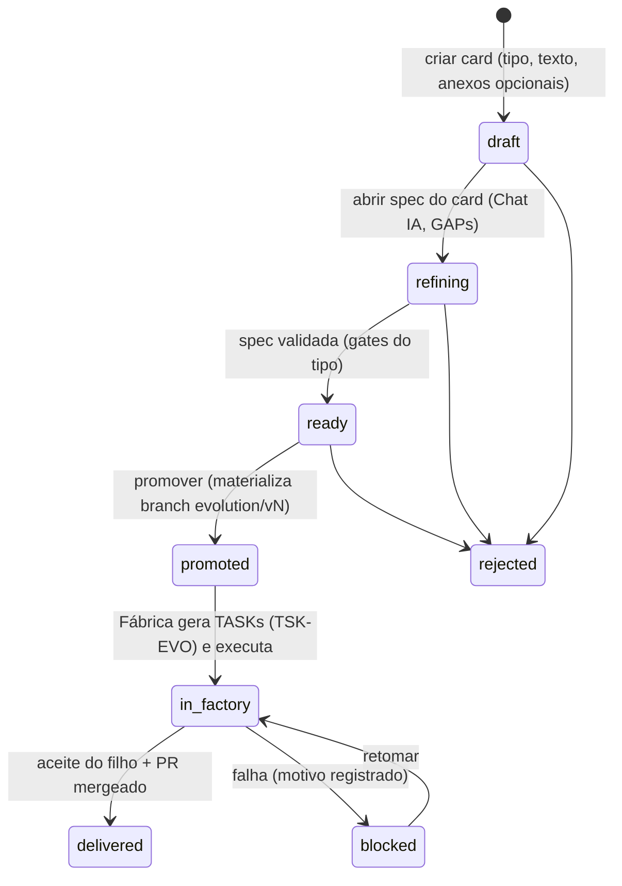

> **Jean Ol'Bar** — AI Engineer · jean@zentriz.com.br

# Evoluir projeto na Bancada, com cards — estudo de viabilidade e desenho recomendado

**v1 (antes da revisão adversarial)** · 2026-11-03 · Estado: **estudo; nada implementado**. Base: [A — estado atual na Fábrica](EVOLUIR-PROJETO-A-estado-atual-fabrica.md) e [B — estado atual na Bancada](EVOLUIR-PROJETO-B-estado-atual-bancada.md) (ambos com `arquivo:linha`, leitura de código, nada executado). Plano de execução: [`../plans/EVOLUIR-PROJETO-BANCADA-plano.md`](../plans/EVOLUIR-PROJETO-BANCADA-plano.md).

## 1. Veredito
**Viável, de esforço médio-grande, e o caminho é evoluir o que já existe, não criar do zero.** O "card" já existe com o nome **Ticket** (RFC-0009, migration 128, tabela `tickets`): tem os 3 tipos pedidos (`evolution`, `fix`, `feature`), número por produto (`TK-0012`), anexos (até 10 × 10 MB), status do pedido e estado de execução derivado do projeto filho. A Fábrica já distingue tarefas novas de processadas (`TSK-EVO-*` para o delta, `TSK-INH-*` para as herdadas como `DONE`). O que falta é **(1)** a superfície na Bancada, **(2)** o vínculo estruturado card → especificações → tasks, **(3)** o marcador explícito de "especificação inicial × derivada", **(4)** a marcação automática de "executado", **(5)** ritos por tipo, **(6)** endurecimento de idempotência e anexos e **(7)** a porta de entrada para produtos sem Auto Care.

A premissa "hoje abre na Fábrica" é só meio verdadeira: o botão e o diálogo ficam na página do projeto, mas `/evolve` já redireciona para a Bancada (`/spec?editProjectId=<filho>&evolve=1`, `projects/[id]/page.tsx:1054-1060`). O fluxo atual é **híbrido**.

## 2. Pedido × estado atual (mapa de lacunas)
| Pedido do Jean | Hoje | Lacuna |
|---|---|---|
| Abrir na Bancada, em cards | Diálogo na página do projeto; a Bancada tem zero referências a ticket | Quadro/lista/criação/detalhe de card na Bancada |
| 3 tipos: Evolução, Correção, Recurso novo | `change_kind ∈ {evolution, fix, feature}` já existe | O tipo é só rótulo; o runner Python nem lê `ticket_*`; todos pagam o mesmo ritual (RFC + Gherkin + escopo) |
| Anexos opcionais | 10 × 10 MB, copiados crus para a árvore de spec | Sem allowlist; binário pode fazer o runner cair em silêncio para só o arquivo primário (`runner.py:951-965`); IA não lê anexo |
| Modo de trabalho sempre "branch git" | `copy` e `branch` seguem o mesmo caminho; `evolution/vN` já é criada quando há repo + GitHub App | Remover a opção `copy`; exigir repo; mensagem clara quando não houver |
| Só depois da 1ª fabricação | `parent.status === 'accepted'` (UI `page.tsx:1376`, API `projects.ts:3411`) | Decidir se `completed` conta (hoje não conta) |
| Todo card gera especificações ligadas a ele | Spec derivada = projeto filho que herda a árvore inteira; ticket é 1:1 com o filho (`child_project_id` único) | Não há card ↔ N specs; spec "do card" × "base" não é marcada |
| Maturar a spec na Bancada (Chat IA, GAPs) | Chat durável e fechamento de GAPs existem, mas operam sobre um `projectId`; o projeto só existe após `/evolve` | Maturar o card **antes** de clonar código/criar branch |
| Distinguir spec inicial × nova | Só implícito pela linhagem | Marcador explícito (`spec_origin`) |
| Fábrica identifica, diferencia, transforma em TASK, executa com a mesma qualidade | `TSK-EVO-*`/`TSK-INH-*`, upsert por `(project_id, task_id)`, Evolution gate + planner | Herança de um nível só; sem coluna task ↔ card; tipo não muda o rito; sem prova de paridade de qualidade |
| Marcar CARDS/TASKS/specs executados | `delivered` só por `PATCH` manual; o aceite não toca `tickets` | Marcação automática no aceite; `rejected/blocked` pela Fábrica |
| Produtos sem Auto Care | O fluxo não depende do Deadpool; correções do Auto Care chegam como PR com `IncidentEnvelope` | Sem porta automática incidente → card; produto sem projeto Genesis aceito não tem onde abrir card |
| Resiliência e idempotência | Boas em tasks/checkpoint/aceite | `/evolve` sem transação, sem lock, sem unicidade `(parent, version)`; promoção do ticket sem `AND status='open'`; chat jobs sem trava por projeto |

## 3. Decisões de arquitetura (opções e recomendação)

### 3.1 O card é uma extensão do Ticket, não uma entidade nova
Reaproveitar `tickets`/`ticket_attachments`, `TK-NNNN`, `materializeTicketIntoSpecTree` e as rotas. Renomear na interface para "Card" e manter o nome técnico `tickets` (migração aditiva). Evita duplicação e preserva o histórico (migration 128). **Recomendado.**

### 3.2 Cardinalidade e onde nasce a spec do card (a decisão central)
| Opção | Descrição | Prós | Contras |
|---|---|---|---|
| **A. 1 card = 1 projeto filho, criado no card ("rascunho do card")** | Ao criar o card, cria-se o filho em `draft` **sem** clonar código nem criar branch (materialização preguiçosa na promoção) | Reaproveita Chat IA, GAPs, snapshots, promoção; N specs por card = N arquivos na pasta do card (`rel_dir`); mantém `tickets.child_project_id` 1:1 | N cards em rascunho = N filhos `draft`; o guard "1 evolução viva por serviço" precisa distinguir `draft` de "em execução"; ordem de integração entre cards |
| B. Cards acumulam num "release" (1 filho recebe N cards) | Entidade intermediária agrupa cards | Menos filhos; uma execução por serviço | Mais complexo; N:M card/spec; o regex de ID de task e o PM precisam entender lotes |
| C. Rascunho do card fora de `projects` (tabela própria de spec do card) | Spec do card em `ticket_spec_files` | Nenhum projeto até promover | Reimplementa Chat IA/GAPs/snapshots para outra entidade (alto custo) |
**Recomendação:** **A na primeira entrega** (menor risco, reaproveita tudo) e **B como evolução futura** se o volume de cards simultâneos exigir. Decisão do Jean (D-E1).

### 3.3 Especificação inicial × derivada
Marcador **explícito** `spec_origin` em `project_spec_files` (`initial` | `card:<TK-id>`), com backfill: arquivos da raiz da linhagem = `initial`. A raiz da linhagem (projeto sem pai) continua sendo a verdade estrutural; o marcador evita inferência. Cada arquivo derivado guarda também `executed_in_project` e `executed_at` quando o aceite ocorre.

### 3.4 Task ↔ card
Não alterar o regex de ID (`TSK-[A-Z]+-\d+`, `runner.py` ~3762-3790; o carimbo `TK-NNNN` fica no commit/PR, fora do ID). Em vez disso: coluna `project_tasks.card_id` (e `origin_spec_file`) preenchida pelo runner a partir do projeto filho (1:1 na opção A), mais **herança transitiva** das tasks `DONE` de todas as versões (hoje só um nível, `runner.py:3911`), com **resumo compacto** das herdadas para não inflar o contexto do CTO/PM.

### 3.5 Ritos por tipo
| Tipo | Rito proposto |
|---|---|
| Correção | "RFC-lite": reprodução + esperado + `files_allowed` derivado; Gherkin mínimo (FAIL_TO_PASS); sem ADR obrigatório |
| Recurso novo | RFC completo + Gherkin + escopo + critérios de aceite |
| Evolução | Rito atual (RFC + ADR/CHANGELOG + escopo por globs) |
O `change_kind` declarado deixa de ser só rótulo: o gate e os prompts do planner/PM leem o tipo. Gates que um tipo dispensa ficam explícitos e testados.

### 3.6 Anexos
Allowlist de tipos (texto/markdown/json/yaml/csv, imagens, PDF) e teto por card; **texto** entra na árvore de spec; **binários** ficam fora dela (tabela de anexos com referência), nunca em `project_spec_files`. O runner passa a **falhar com erro claro** ao não conseguir ler um arquivo, em vez de cair em silêncio. Interpretação por visão/PDF é fase posterior e opcional, com custo controlado.

### 3.7 Git
Sempre `branch`: remover `copy` da interface; exigir repositório + GitHub App (mensagem clara se faltar). Branch `evolution/vN` (um filho por card na opção A), PR por card com `TK-NNNN` no título e no commit. Merge do PR + aceite do filho = card entregue.

### 3.8 Disponibilidade
Manter a regra "só depois de fabricado": o botão/ação só aparece quando existe ao menos um projeto da linhagem `accepted`. **Pergunta ao Jean (D-E2):** `completed` também conta? Hoje não conta. Recomendação: contar `accepted` e `completed`, e expor `factory_built_at` como campo calculado.

### 3.9 Máquina de estados do card
`draft → refining → ready → promoted → in_factory → delivered`, mais `blocked` (falha da Fábrica, com motivo) e `rejected` (decisão humana). Transições persistidas, idempotentes (`UPDATE … WHERE status = <esperado>`), com trilha de auditoria. O estado `delivered` é marcado **automaticamente** pelo aceite do filho; tasks e specs do card recebem o carimbo de execução.

### 3.10 Paridade de qualidade com a 1ª versão
Métricas de comparação: aprovação do QA na 1ª tentativa, taxa de rework, gates passados, cobertura dos testes herdados (**PASS_TO_PASS do pai** + FAIL_TO_PASS do card), custo por entrega. Um cenário "dourado" de evolução (produto de referência + 3 cards, um de cada tipo) roda com LLM simulado em CI e, periodicamente, com LLM real em ambiente de homologação.

### 3.11 Produtos sem Auto Care
O caminho do card **não depende do Deadpool**; o que exige projeto Genesis pai `accepted` é a evolução. Para produtos **sem** projeto Genesis, introduzir mais tarde o cadastro de "produto externo" (repositório + estado base) como porta de entrada. Para o Auto Care: conversor `IncidentEnvelope` → card de Correção, **com aprovação humana** e token de serviço restrito (hoje o token do runner é recusado em `POST /api/products/:id/tickets`).

### 3.12 Custo e resiliência
Orçamento por card = percentual do orçamento do projeto-filho (alinhado ao desenho de controle de gasto, doc evolution/27); o Guard continua soberano. Resiliência: criação transacional, unicidade `(parent_project_id, version_number)`, trava "um filho vivo por serviço" por índice parcial, promoção idempotente, reconciliador que cura órfãos (filho sem ticket, ticket promovido sem filho), chat jobs com trava por projeto, retomada por checkpoint.

## 4. Riscos principais
| Risco | Mitigação |
|---|---|
| Regressão do fluxo atual de evolução | Flag `CARDS_BANCADA`; migrações aditivas; o diálogo atual continua até a flag ligar |
| Evolução duplicada em corrida | Unicidade + transação + chave de idempotência por promoção |
| Anexo binário derrubando a spec | Allowlist, binário fora da árvore, erro explícito |
| Contexto do CTO/PM inflando com a herança transitiva | Resumo compacto das herdadas; limite de tokens |
| Cards simultâneos no mesmo serviço | Serialização por índice parcial; fila; (opção B no futuro) |
| Custo de LLM por card sem teto | Orçamento por card; Guard soberano |
| Paridade de qualidade não provada | Cenário dourado e métricas antes de abrir para todos |
| Front sem testes (um único teste) | Infra mínima de teste de componente e E2E antes da UI |

## 5. Decisões do Jean (resumo)
D-E1 cardinalidade (recomendo A, B depois) · D-E2 `completed` conta como fabricado? (recomendo sim) · D-E3 ritos por tipo (recomendo o quadro do §3.5) · D-E4 política de anexos (recomendo o §3.6) · D-E5 produtos externos (recomendo adiar) · D-E6 Deadpool → card automático (recomendo com aprovação humana) · D-E7 orçamento por card em percentual · D-E8 status oficial do RFC-0009 (consta "Rascunho" apesar de implementado).

## 6. Lacunas deste estudo
Leitura de código, sem execução; o comportamento real de binários, de `fileSize` multipart, de checkpoint corrompido e a possível incompatibilidade de status (`/evolve` deixa o filho em `spec_submitted`, `/promote` exige `draft`) estão `[não verificados em execução]`. Não há estimativa de tickets existentes em produção para a migração.
